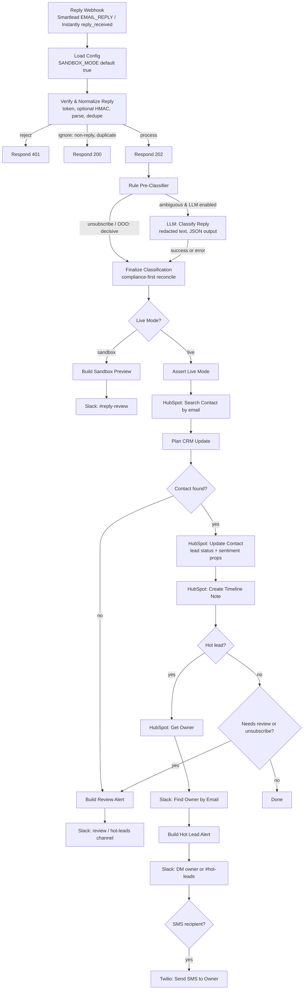

# n8n Smartlead Reply Sentiment Router

[](LICENSE)
[](https://github.com/dhrobinsystems/n8n-smartlead-reply-sentiment-router/actions/workflows/ci.yml)
[](https://n8n.io)
[](package.json)

**Every cold-email reply, classified and actioned in seconds.** This n8n workflow catches reply webhooks from **Smartlead** or **Instantly**. It classifies each reply as **positive, neutral, objection, out-of-office or unsubscribe**, using deterministic rules plus an optional LLM. It then updates the contact's **HubSpot lead status and timeline**, and sends high-intent replies straight to the **account owner on Slack, or by SMS** through Twilio.

Built and maintained by **DH Robin** ([dhRobin Systems](https://dhrobinsystems.com), `dhrobinsystems`).

---

## Table of contents

- [What it does](#what-it-does)
- [Flow diagram](#flow-diagram)
- [Node-by-node reference](#node-by-node-reference)
- [Classification design](#classification-design)
- [Safety rails](#safety-rails)
- [Setup](#setup)
- [Environment variables](#environment-variables)
- [Developer workflow](#developer-workflow)
- [Troubleshooting](#troubleshooting)
- [Disclaimer](#️-disclaimer--liability-limitation)
- [License](#license)

---

## What it does

| Reply category | HubSpot `hs_lead_status` (default) | Routing |
| --- | --- | --- |
| **positive** (confidence ≥ `HOT_LEAD_MIN_CONFIDENCE`) | `IN_PROGRESS` | Slack DM to the HubSpot contact owner (fallback `#hot-leads`) + optional SMS |
| **neutral** | `CONNECTED` | Timeline note only (review alert if low confidence) |
| **objection** | `BAD_TIMING` | Timeline note only |
| **out_of_office** | *unchanged* | Timeline note only |
| **unsubscribe** | `UNQUALIFIED` (+ optional do-not-contact checkbox) | Compliance alert in `#reply-review` |

Every processed reply also writes `last_reply_sentiment`, `last_reply_sentiment_confidence` and `last_reply_received_at`, plus a timeline note with the category, the reason, the campaign and a short reply excerpt. Replies that match no HubSpot contact go to the review channel. Clearly positive ones go to `#hot-leads`, so no hot lead is lost.

---

## Flow diagram



---

## Node-by-node reference

| # | Node | Purpose |
| --- | --- | --- |
| 1 | **Reply Webhook (Smartlead / Instantly)** | `POST /webhook/cold-email-reply`. Keeps the raw body for signature checks and replies through Respond nodes. |
| 2 | **Load Config** | Validates every environment variable and fails fast. Emits a *redacted* config, so secrets never appear in execution logs. |
| 3 | **Verify & Normalize Reply** | Shared-token check, optional Smartlead HMAC, payload normalization for both platforms, removal of quoted history and signatures, duplicate-delivery check. |
| 4 | **Process Reply? / Rejected?** + 3 Respond nodes | `202` accepted, `401` bad token or signature (Smartlead does not retry 4xx), `200` ignored (non-reply events, duplicates). |
| 5 | **Rule Pre-Classifier** | Deterministic rules. Unsubscribe and out-of-office replies are decided here and never depend on an LLM. |
| 6 | **LLM Needed? → LLM: Classify Reply** | OpenAI or Anthropic over HTTP with an n8n Header Auth credential. Strict JSON output. Errors continue to the fallback. |
| 7 | **Finalize Classification** | Combines the rule and LLM results: unsubscribe from either source wins, and low confidence or disagreement is flagged for review. |
| 8 | **Live Mode?** | Fail-safe gate: only `mode === "live"` reaches the CRM and alert nodes. |
| 9 | **Build Sandbox Preview → Slack** | Dry run: shows the category and everything live mode *would* do. |
| 10 | **Assert Live Mode** | Re-reads `SANDBOX_MODE` and throws if sandbox is on (defense in depth). |
| 11 | **HubSpot: Search Contact → Plan CRM Update** | Finds the contact by email and builds the exact properties, note and routing plan. |
| 12 | **HubSpot: Update Contact → Create Timeline Note** | Writes `hs_lead_status`, the sentiment properties and a note associated to the contact (association type 202). |
| 13 | **Hot Lead? → Get Owner → Find Owner by Email → Build/Post Hot Lead Alert** | DMs the owner, falling back to `SLACK_HOT_LEADS_CHANNEL`. |
| 14 | **SMS Recipient? → Twilio: Send SMS to Owner** | Optional. The text contains first name + company only. |
| 15 | **Needs Review or Unsubscribe? → Build/Post Review Alert** | Compliance and quality-control alerts in `SLACK_REVIEW_CHANNEL`. |

All logic lives in `src/` and is compiled into the Code nodes by `npm run build`, so the workflow and the tested code can never drift apart (CI enforces this).

---

## Classification design

1. **Clean the text first.** Quoted threads ("On ... wrote:", Outlook headers, `>` lines), mobile footers and `--` signatures are removed, so the original pitch can't sway the classifier.
2. **Rules run on every reply** (`src/sentimentParser.js`), in priority order: unsubscribe, then out-of-office, then objection, then positive. "Not interested" is always an objection, never a positive.
3. **The LLM is called only when it adds value:** never for unsubscribe or out-of-office replies, never when `LLM_PROVIDER=none`, and not in sandbox unless `LLM_IN_SANDBOX=true`.
4. **Data minimization:** emails, phone numbers and URLs are replaced with `[email]`, `[phone]` and `[url]` before text is sent to the LLM. The reply is wrapped in `<reply>` tags and treated as untrusted (prompt-injection safe).
5. **Reconciliation, compliance first:** an unsubscribe signal from **either** source wins. Otherwise the LLM result is used, but `needsReview` is set when its confidence is below `LLM_MIN_CONFIDENCE` or it disagrees with a rule match. If the LLM fails, the rule result is used. If nothing matches, the reply is `neutral` and flagged for review.
6. **Hot-lead routing** requires `positive`, no review flag, and confidence ≥ `HOT_LEAD_MIN_CONFIDENCE` (0.75 by default). A rules-only positive (0.70) therefore never pings a rep on its own.

---

## Safety rails

- **`SANDBOX_MODE=true` by default.** No HubSpot writes, owner DMs or SMS, only an internal preview. Typos keep sandbox on.
- **The workflow ships inactive**, and all credential IDs are `REPLACE_WITH_YOUR_CREDENTIAL_ID`.
- **Webhook authentication:** a shared token is required in live mode (`?token=` or the `X-Webhook-Token` header). Smartlead HMAC verification is added when `SMARTLEAD_WEBHOOK_SECRET` is set.
- **Duplicate deliveries are ignored**, using a hashed content key and a TTL ledger in workflow static data (no email addresses are stored there).
- **Static sandbox proof:** `npm run check` walks the workflow graph and fails if any CRM-writing or messaging node can run without passing the live gate.
- **No PII in the repo:** sample payloads use fictional names and reserved `example.*` domains, and the checker rejects anything else in `samples/`.

---

## Setup

### 1. n8n host

Set the variables from [`.env.example`](.env.example) on the n8n host, plus:

```yaml
environment:
  - N8N_BLOCK_ENV_ACCESS_IN_NODE=false   # Code nodes read config from env
  - NODE_FUNCTION_ALLOW_BUILTIN=crypto   # only if SMARTLEAD_WEBHOOK_SECRET is used
  - SANDBOX_MODE=true
```

### 2. HubSpot

1. Create a **private app** with read and write access to contacts, read access to owners, and permission to create notes. Scope names change over time, so select them in HubSpot's scope picker. In n8n, create a **HubSpot App Token** credential.
2. Create the custom **contact** properties, or set `HUBSPOT_WRITE_SENTIMENT_PROPERTIES=false`:

   | Internal name | Type |
   | --- | --- |
   | `last_reply_sentiment` | Single-line text (or dropdown with the 5 categories) |
   | `last_reply_sentiment_confidence` | Number |
   | `last_reply_received_at` | Date picker / datetime |
   | *(optional)* `outbound_do_not_contact` | Single checkbox, then set `HUBSPOT_DNC_PROPERTY` |

3. If your portal uses custom lead-status values, map them with `HUBSPOT_LEAD_STATUS_MAP`.

### 3. Slack

Create a Slack app with the bot scopes `chat:write`, `users:read` and `users:read.email`. Install it, create a **Slack API** credential in n8n, and invite the bot to `SLACK_REVIEW_CHANNEL` and `SLACK_HOT_LEADS_CHANNEL`. Owner DMs work when the HubSpot owner's email matches their Slack email.

### 4. LLM (optional)

Set `LLM_PROVIDER` (`openai` or `anthropic`) and `LLM_MODEL`, then create a **Header Auth** credential:
- OpenAI: name `Authorization`, value `Bearer <key>`
- Anthropic: name `x-api-key`, value `<key>`

### 5. Twilio SMS (optional)

Create an **HTTP Basic Auth** credential (user = Account SID, password = Auth Token). Then set `SMS_ENABLED=true`, `TWILIO_ACCOUNT_SID`, `TWILIO_FROM_NUMBER` and `OWNER_SMS_MAP` (`{"<hubspotOwnerId>":"+1XXXXXXXXXX"}`). Make sure your messaging use case is registered as required in your country (for example A2P 10DLC in the US).

### 6. Import & connect

1. In n8n, open **Workflows → Import from File** and choose `workflow.json`.
2. Select your credentials on every flagged node.
3. Copy the webhook **Production URL**, then:
   - **Smartlead:** create a webhook for the `EMAIL_REPLY` event pointing to `<production-url>?token=<WEBHOOK_SHARED_TOKEN>`.
   - **Instantly:** create a webhook for `reply_received` (optionally `auto_reply_received`) and add the custom header `X-Webhook-Token: <WEBHOOK_SHARED_TOKEN>`.
4. Activate the workflow, send a test reply, and review the **SANDBOX DRY RUN** message in `#reply-review`.
5. When the previews look right, set `SANDBOX_MODE=false` and restart n8n.

> Field names in webhook payloads can vary by platform version and account. `normalizeReplyPayload()` accepts the documented variants. Always confirm with a real test reply before going live, and check that the lead email resolves to the *prospect*, not your sending mailbox.

---

## Environment variables

| Variable | Default | Description |
| --- | --- | --- |
| `SANDBOX_MODE` | `true` | Dry run: preview only. `false` enables HubSpot writes and alerts. |
| `WEBHOOK_SHARED_TOKEN` | *(empty)* | ≥ 24 chars. Required in live mode. |
| `SMARTLEAD_WEBHOOK_SECRET` | *(empty)* | Enables `X-Smartlead-Signature` HMAC verification. |
| `ACCEPTED_PLATFORMS` | `smartlead,instantly` | Platforms to process. |
| `DEDUPE_TTL_HOURS` | `72` | Duplicate-delivery window. |
| `LLM_PROVIDER` / `LLM_MODEL` | `none` / *(empty)* | `openai` or `anthropic` plus a model name. |
| `LLM_MAX_TOKENS` | `300` | Output cap for the classification call. |
| `LLM_MIN_CONFIDENCE` | `0.6` | Below this, the reply is flagged for review. |
| `LLM_IN_SANDBOX` | `false` | Allow LLM calls during sandbox runs. |
| `HUBSPOT_PORTAL_ID` | *(empty)* | Builds contact links in Slack. |
| `HUBSPOT_LEAD_STATUS_MAP` | see table above | JSON overrides per category (`null` = leave unchanged). |
| `HUBSPOT_WRITE_SENTIMENT_PROPERTIES` | `true` | Write the `last_reply_*` properties. |
| `HUBSPOT_DNC_PROPERTY` | *(empty)* | Checkbox property set to `true` on unsubscribe. |
| `NOTE_REPLY_EXCERPT_CHARS` | `500` | Reply excerpt length in the note (0 = none). |
| `HOT_LEAD_MIN_CONFIDENCE` | `0.75` | Threshold for owner alerts. |
| `SLACK_HOT_LEADS_CHANNEL` | `#hot-leads` | Fallback for owner alerts. |
| `SLACK_REVIEW_CHANNEL` | `#reply-review` | Sandbox previews, unsubscribes, unmatched and low-confidence replies. |
| `SLACK_DM_OWNERS` | `true` | DM the owner instead of posting to the channel. |
| `SMS_ENABLED` | `false` | Twilio SMS for hot leads. |
| `TWILIO_ACCOUNT_SID` / `TWILIO_FROM_NUMBER` | *(empty)* | Required when SMS is enabled. |
| `OWNER_SMS_MAP` | *(empty)* | JSON: HubSpot owner ID to E.164 mobile number. |

---

## Developer workflow

```bash
git clone https://github.com/dhrobinsystems/n8n-smartlead-reply-sentiment-router.git
cd n8n-smartlead-reply-sentiment-router
npm test          # 44 tests, zero dependencies, no network
npm run classify -- samples/smartlead-email-reply.example.json   # offline classification
npm run build     # compile src/*.js into workflow.json Code nodes
npm run check     # sync, credentials, secrets, sandbox-gate proof
```

Repository layout:

```
├── workflow.json                 # importable n8n workflow (generated regions + node glue)
├── src/
│   ├── sentimentParser.js        # parsing, rules, LLM prompt/response, reconciliation
│   ├── replyRouter.js            # webhook auth, dedupe, HubSpot plan, Slack/SMS payloads
│   └── config.js                 # env parsing & validation
├── scripts/
│   ├── build-workflow.js         # build + --check
│   └── classify-sample.js        # offline dry run
├── tests/                        # node --test, incl. a harness that runs workflow Code nodes
├── samples/                      # fictional Smartlead & Instantly payloads (example.* only)
├── .github/workflows/ci.yml      # Node 20 & 22: test, check, build drift
├── .env.example
├── DISCLAIMER.md
└── LICENSE
```

---

## Troubleshooting

| Symptom | Likely cause |
| --- | --- |
| `Invalid configuration` in **Load Config** | A variable failed validation. The error lists every problem. |
| Every request returns `401 missing_token` | Live mode without `?token=` or `X-Webhook-Token`. |
| `$env` warnings, workflow stuck in sandbox | `N8N_BLOCK_ENV_ACCESS_IN_NODE` is still `true` on the host. |
| HubSpot `400` on **Update Contact** | The custom `last_reply_*` properties don't exist yet, or a lead-status value isn't valid in your portal. |
| Owner alerts land in `#hot-leads` | The owner's HubSpot email doesn't match a Slack user, or the `users:read.email` scope is missing. |
| `Module 'crypto' is disallowed` | Set `NODE_FUNCTION_ALLOW_BUILTIN=crypto` (only needed with `SMARTLEAD_WEBHOOK_SECRET`). |

---

## ⚠️ Disclaimer & Liability Limitation

Use at your own risk. The code, workflows, and scripts provided in this repository (`n8n-smartlead-reply-sentiment-router`) are for educational and architectural demonstration purposes.

- **No Liability:** The author and dhRobin Systems assume no responsibility or liability for any direct, indirect, incidental, or consequential damages resulting from the use, misuse, or deployment of these scripts.
- **No Warranty:** All software, n8n JSON blueprints, and JavaScript modules are provided "AS IS" without warranty of any kind, express or implied, including but not limited to merchantability, fitness for a particular purpose, or non-infringement.
- **Production Testing Required:** Always test thoroughly in an isolated staging environment with `SANDBOX_MODE=true` enabled before connecting live HubSpot, Slack, Twilio, Smartlead, Instantly, or LLM provider credentials.
- **Third-Party APIs & Compliance:** Users are solely responsible for complying with the terms of service, rate limits, data privacy regulations (GDPR/CCPA), anti-spam laws (e.g. CAN-SPAM, CASL, PECR), and security policies of HubSpot, Slack, Twilio, Smartlead, Instantly, and any connected LLM providers, including honouring every unsubscribe request.

> The full disclaimer is also available in [DISCLAIMER.md](DISCLAIMER.md).

---

## License

Released under the [MIT License](LICENSE). Copyright (c) 2026 DH Robin (dhRobin Systems).
